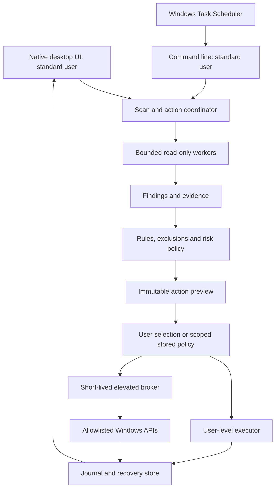

# PC Steward: proposed product design

Research date: 18 October 2026, Asia/Calcutta. Status: proposed, awaiting design review. Working name only.

## Intent and definition of success

Build a public, open-source Windows desktop suite that makes disk usage understandable, safely recovers disposable storage, diagnoses performance problems, and maintains approved settings on a schedule. The requested comparison set is CCleaner's paid offerings, BleachBit, Ashampoo WinOptimizer and WinDirStat. All implemented local features will be available without an artificial premium paywall.

Success is a working, installable application with real Windows integrations, accurate scan coverage, evidence for recommendations, explicit action previews and tested recovery. Space recovered is not interchangeable with speed gained. We will measure both separately. We cannot guarantee permanent peak performance or universal malware detection.

The user specified public open-source distribution. The following are proposed engineering decisions, not preferences already approved by the user: GPL-3.0-or-later; C#/.NET 10 and WPF; Windows 11 x64 first; original branding; local processing by default; phased delivery; no automatically disabled services based only on inferred usefulness.

See [feature matrix](../../feature-matrix.md) for included, restricted, dependent and deferred capabilities. Full parity is an ongoing, versioned program, not the label of the first release.

## Product experience

Navigation will contain these pages, added as their implementations become functional:

| Page | What the user can do |
|---|---|
| Overview | See free storage, current resource pressure, security/update findings, last scan, incomplete coverage and next maintenance window. Start a scan or review a proposed action plan. |
| Cleaner | Inspect findings by category, application and file; keep exclusions; choose recoverable cleanup or explicitly permanent deletion. |
| Disk Map | Explore a WinDirStat-style folder table, synchronized treemap, file-type legend and largest files; compare logical/allocated bytes and scan snapshots. |
| Apps & Services | Subviews for apps, startup, tasks, extensions, processes and services; inspect publisher, impact and dependencies before approved changes. |
| Security | Separate malware, vulnerability and protection views, with evidence/confidence, CVE reports, source freshness and reviewed remediation. |
| Health & Updates | Inspect hardware/storage indicators, Windows/app update status, crash summaries and maintenance recommendations; cross-link security findings. |
| Privacy | Manage separately selected browser traces, cookie keep-lists and local application history. Explain effects on sign-in and offline data. |
| Automation | Configure schedules, scope, battery/idle conditions, exclusions, notification thresholds and preapproved action rules. |
| Recovery & History | Inspect per-item outcomes, quarantined files, settings snapshots, failed restores and irreversible actions. |
| Advanced Tools | Access supported repairs and later specialist utilities with individual risk explanations. |

Native keyboard navigation, screen-reader labels, high-contrast mode, scalable text, light/dark themes, progress, cancellation, accessible table alternatives to the treemap, and clear unavailable states are requirements. No alarming red health score simply because optional cookies or registry entries exist.

The user-requested Security extension and updated UI grouping are specified in [Security and UI addendum](../../security-and-ui-addendum.md). Its matching, privacy, report and test requirements are normative for the added features. The interactive concept is illustrative, not application code or real scan results.

Typical flow: **scan → inspect evidence → select actions → review impact/recovery → execute → verify → show actual outcome**. An interrupted or partially inaccessible scan is never labelled complete. Read-only scanning requires no elevation when the selected paths are accessible.

## Architecture decision

| Approach | Benefits | Costs / decision |
|---|---|---|
| C#/.NET 10 + WPF | Direct Windows integration, mature native UI/data binding, one application language, no browser runtime | Recommended. Custom treemap drawing and careful native interop are required. Windows-only fits this request. |
| Rust + Tauri | Strong memory safety; web UI ecosystem | Adds Rust/JavaScript boundaries, webview permissions and Windows integration work. Viable if cross-platform becomes a primary goal. |
| C++/WinUI or WinDirStat fork | Native filesystem performance and possible direct engine reuse | Larger native safety burden and UI integration cost. Consider a bounded scanner component after profiling, not a full-suite starting point. |

WPF is Windows-only and open source; .NET 10 is an active LTS release. The development machine currently has SDK 9.0.316, so implementation must acquire and pin a supported .NET 10 SDK rather than silently target the older installed SDK. [WPF documentation](https://learn.microsoft.com/en-us/dotnet/desktop/wpf/overview/), [.NET support policy](https://dotnet.microsoft.com/en-us/platform/support/policy).

Use a modular monolith with separate executables for the GUI, CLI and privileged broker. Shared libraries hold domain models, scan engines, policy and platform adapters. Do not begin with microservices, a kernel driver, a cloud account or a constantly elevated service.

Proposed solution boundaries:

- `src/Steward.App`: WPF views, view models and accessibility.
- `src/Steward.Core`: findings, plans, policy, rules and state transitions; no direct OS mutation.
- `src/Steward.Windows`: explicitly named Windows adapters and capability probes.
- `src/Steward.Storage`: bounded enumeration, allocation accounting, snapshots and duplicate analysis.
- `src/Steward.Broker`: minimal privileged commands and independent validation.
- `src/Steward.Cli`: scans, report export and scheduled execution.
- `tests/`: domain, adversarial filesystem, IPC, VM integration and UI tests.

Start with SQLite for bounded scan indexes, settings and nonprivileged history, subject to dependency/license review. Store privileged approvals and recovery metadata in an independently protected location; an editable user database cannot authorize administrator actions. Use streaming batches and virtualized UI rows instead of holding a million UI objects in memory.

## Scan and rule contracts

Each finding has an ID, source/rule version, scan timestamp, target identity, category, measured size or resource data, reason, confidence, risk, coverage limitations and permitted actions. An app's last-access timestamp is only a weak signal; use history collected with consent and explicit “unknown” states.

A rule contains an application detector, supported version ranges, allowed roots, bounded relative selectors, minimum age, app-running constraints, exclusions, risk class, recovery capability and test fixtures. Upstream cleaner definitions are data requiring review, not authority to execute commands. Reject arbitrary scripts, process launches, unbounded regex, unrestricted registry edits and rules outside approved roots. Custom user rules cannot gain elevation by changing a risk label.

Each action plan binds the selected findings to exact file/service/package identities, preconditions, requested operations, maximum scope, expiry, ruleset digest, expected consequences and recovery type. Never turn a preview into a new unrestricted glob at execution time.

States: proposed → approved → revalidated → executing → completed/partial/failed/cancelled → restore-requested → restored/restore-partial/restore-failed. Persist the intention before changes and item-level results after them. A crash must leave discoverable pending work; exactly-once completion must not be assumed.

## Safe cleanup and disk accounting

Initial automatic candidates: specifically selected aged temporary files and tested disposable cache categories. Downloads, Desktop, Documents, browser profiles, credentials, cookies, localStorage, IndexedDB, AI conversations/models, recovery files, backups and source repositories are excluded from default automatic cleanup. Some caches improve performance; explain re-download/rebuild costs.

Enumeration must handle long/Unicode paths, hard links, sparse/compressed files, inaccessible directories, locked files, changing files, mount points, network loss and cancellation. Do not follow directory reparse points or hydrate cloud placeholders by default. Show apparent file sizes separately from allocated/deduplicated physical usage and volume free space; those totals need not match. [Microsoft reparse-point documentation](https://learn.microsoft.com/en-us/windows/win32/fileio/reparse-points).

Before mutation, resolve the approved root and target with handle-based checks, reject disallowed reparse traversal and verify identity again at execution. A string-prefix check alone is insufficient. Test path swaps, junction replacement and hard-link attacks between preview and execution. Reparse-safe deletion is a security release gate, not a later enhancement.

Recoverable cleanup uses the Recycle Bin where supported or an app quarantine with a journal. **Moving files to a same-volume quarantine or Recycle Bin does not normally free that volume's space.** Report “moved to recovery” separately from “space reclaimed”; measure actual free-space changes and explain retention/purge. If storage is critically low, do not secretly bypass recovery. Offer a specific permanent purge choice. No fallback from failed recycling to permanent deletion without fresh approval. [Shell deletion flags](https://learn.microsoft.com/en-us/windows/win32/api/shobjidl_core/nf-shobjidl_core-ifileoperation-setoperationflags).

Duplicates: group by length, optionally prefilter with sampled hashes, then full content hash and final comparison before user-approved removal. Revalidate source identity and keep at least one chosen original. Equal file names, sampled hashes or timestamps are not proof of duplicate content. Exclude system/application managed data and cloud placeholders by default.

## Service and application optimization

Collect process/service inventory and bounded CPU, memory and I/O history. Display publisher verification, startup source, dependencies and measurement period. Unsigned, idle, unfamiliar or rarely used does not equal malicious or unnecessary. “Questionable” means review evidence, not an automatic kill list.

Default behavior is recommendation only. Users may explicitly create named profiles for selected noncritical third-party software; stop services gracefully and restore recorded start settings later. Do not kill a shared service host, disable dependency chains blindly, stop security tools, or manipulate kernel/protected processes. Terminated applications can lose unsaved work and generally cannot be restored to their previous state. Profiles must distinguish service restart from application-state restoration.

Scheduled service/app changes are off by default. Any later opt-in is bound to specific service identities, dependencies, machine state and approved rules, with a small blast-radius limit, a restore path, and automatic suspension after failures. Dynamic “AI says unused” execution is excluded. Security findings come from Defender or explicitly integrated security engines; signature status is supporting evidence only. [Service control API](https://learn.microsoft.com/en-us/windows/win32/api/winsvc/nf-winsvc-controlservice), [WinVerifyTrust](https://learn.microsoft.com/en-us/windows/win32/api/wintrust/nf-wintrust-winverifytrust).

## Automation and performance

Proposed defaults: a daily lightweight read-only health check and weekly user-selected disk/cleanup preview, only after the user enables scheduling. No schedules are installed by this research task. Use Task Scheduler; avoid overlapping runs, pause on active interaction or resource pressure, respect battery/AC and quiet hours, and bound duration and I/O. Notify only for meaningful changes, failed jobs or action required.

A low-space trigger suggests a plan; it does not authorize wider deletion. Repeated failure disables the affected rule and preserves evidence. A permanent purge needs a separate retained user policy with category, age, scope and byte caps. Recheck those limits at execution.

Proposed performance acceptance budgets, to be measured rather than claimed: UI response within 200 ms for ordinary interactions; cancellation acknowledgement within one second, with blocked OS operations explicitly reported; idle UI memory target below 150 MB on the declared reference PC; no always-running scanner by default; million-file scans use bounded memory/indexing. Resource-heavy hash/benchmark jobs are explicit and cancellable. Scanner throughput is benchmarked on a fixed corpus and hardware; no invented “X% faster PC” promise.

## Security model

Threats include malicious cleaner rules, manipulated paths, untrusted scan snapshots, hostile local users, compromised downloads, dependency supply-chain attacks and leaked diagnostic data.

1. Run GUI/scanners as standard user. Elevate a short-lived helper only for reviewed administrative operations. [Microsoft broker model](https://learn.microsoft.com/en-us/windows/win32/secauthz/administrator-broker-model).
2. Authenticate IPC, restrict named-pipe ACLs, bind to user/session and a fresh nonce, validate operation IDs, reject replay/expired plans, cap message sizes and use independently checked target policy. Do not trust a client-supplied “approved” boolean or arbitrary command line.
3. An elevated broker binary must be installed in an administrator-protected location. A portable build can scan and perform user-level cleanup; it does not install a highest-privilege scheduled task pointing into a user-writable folder.
4. Elevated scheduled work reads only administrator-protected allowlists and task configuration. No low-privilege user can edit the instruction path, executable or operation scope. [Task security](https://learn.microsoft.com/en-us/windows/win32/taskschd/security-contexts-for-running-tasks).
5. Signed releases and signed rule manifests, pinned signing trust, rollback/version protection, key-rotation procedure, checksums, dependency locks, SBOM and protected release credentials. No remote executable plugins in the first release.
6. Local processing by default. No filename lists, browsing history, file content or application inventory leaves the machine automatically. Diagnostic export redacts user paths and requires selection. Online reputation lookup is separate opt-in; never upload suspicious files automatically.
7. Quarantine and logs inherit restrictive ACLs; apply explicit retention and size limits. Store future OAuth tokens using Windows-protected secrets; do not persist them in logs or plaintext settings. Never read browser passwords to clean a cache.
8. Respect organization policies, tamper protection, pinned packages, third-party antivirus and unavailable permissions. Display “unavailable/managed” instead of “healthy.”

Trusted administrative consent is obtained **inside the elevated broker's own native review window**, after it reconstructs and validates the exact operation and targets. UAC authorizes elevation; it does not replace this action-specific review. The broker creates the protected approval record and executes only that reviewed plan. The ordinary GUI cannot manufacture a trusted approval. Approving an administrative schedule similarly occurs in the broker and creates a narrowly scoped administrator-protected policy; the scheduled runner revalidates it on every execution. This boundary protects against an unelevated compromised client; compromise of an administrator or the broker itself is outside that guarantee.

For the first release, elevation supports a same-user split-token administrator only: the requesting and elevated user SID must match. Refuse elevation using a different administrator's credentials rather than silently redirecting user paths or recovery state. Standard users retain scanning and permitted user-level cleanup. Cross-user maintenance in milestone D requires a separate reviewed delegation model with explicit target-user selection, authorization, and isolated recovery; it is not implicitly enabled by elevation.

System Restore is supplementary, not file backup or universal rollback. Settings can change outside the app; restore compares the current state and asks about conflicts rather than overwriting unrelated changes. Shredding, some uninstalls, update/driver changes and component cleanup are not reliably reversible. [Restore-point constraints](https://learn.microsoft.com/en-us/powershell/module/microsoft.powershell.management/checkpoint-computer?view=powershell-5.1).

## Licensing and public release

Recommend **GPL-3.0-or-later** for original application code and contributed rules. BleachBit explicitly applies this license to source and cleaner definitions; WinDirStat advertises GPL v3 or later. Reuse must preserve provenance and notices and review file-specific exceptions and bundled dependencies. A native WinDirStat engine is not automatically a compatible C# library: review architecture before porting or integrating it. [BleachBit license statement](https://github.com/bleachbit/bleachbit), [WinDirStat license](https://github.com/windirstat/windirstat/blob/master/LICENSE.md).

For every public binary release, provide matching source, required build scripts, license text and third-party notices in a durable release location. Maintain SPDX identifiers, dependency inventory/SBOM and contribution provenance (proposed Developer Certificate of Origin sign-off). GPL obligations depend on what is distributed and how it is combined; verify each imported component instead of assuming all free downloads are compatible. [GNU GPLv3](https://github.com/bleachbit/bleachbit/blob/master/COPYING).

REA's own code is MIT-licensed; its external tools retain separate licenses. REA is a development investigation tool, not a runtime dependency of the cleaner. Reading a vendor's feature documentation does not grant permission to redistribute its binaries, artwork, proprietary driver catalogs or cloud services. Use original names, layout and artwork; no CCleaner/Ashampoo branding or activation logic. [REA license](https://github.com/morluto/rea/blob/main/LICENSE), [third-party notices](https://github.com/morluto/rea/blob/main/THIRD_PARTY_NOTICES.md).

CCleaner's product page asserts patent coverage for cleaning/Performance Optimizer technology. This is a vendor claim, not a conclusion that our design infringes or is cleared. Public release of closely matching behavior needs a jurisdiction-specific freedom-to-operate review; licensing and patent questions cannot be settled by choosing GPL alone. [Vendor statement](https://www.ccleaner.com/ccleaner?source=cpc).

Costs remain for code signing, release infrastructure, compatibility machines/VMs and maintenance. VPN hosting, reputation data, broad driver catalogs, cloud APIs and human support need separate funding and operating arrangements. A public open-source license does not make those services free.

## Explicit limits and later decisions

- No generic registry speed-up/defragmentation, routine RAM purging, prefetch/SysMain disabling, timer/network magic, security weakening or indiscriminate service termination.
- Windows 11 x64 is the initial supported target; ARM64, older Windows and server/managed environments require separate compatibility gates. Windows 10 compatibility is not a promise of OS security support.
- Advanced recovery, guaranteed media sanitization, VPN infrastructure and full driver-database parity are separate projects. Preserve these requirements in the roadmap; do not show fake working buttons.
- Exact browser/app cleaning coverage grows through tested rules; version mismatches disable risky rules.
- Final brand, copyright owner, signing identity, public repository location and hosted-service budget remain release decisions. They do not prevent implementing the approved local core.

Builder may choose routine internal libraries, exact class layouts, rendering algorithms and test frameworks consistent with these constraints. Scope changes affecting destructive automation, external data transmission or licensing return for design review.
